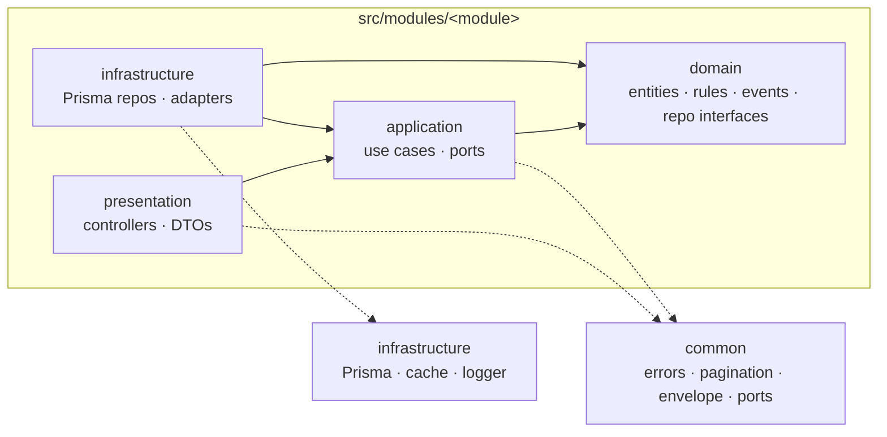

# SewaPro API

Backend for **SewaPro**, a local home-service marketplace for Nepal (Kathmandu first). Customers find and book verified providers (electricians, plumbers, carpenters, AC technicians, cleaners, mechanics); admins verify providers and run the platform.

NestJS 12 (ESM) · TypeScript 6 (strict) · PostgreSQL + Prisma 7 · Vitest + Supertest · Bun (package manager)

> **Status:** Step 1 (platform scaffold) complete. Business modules are added step by step; see [Roadmap](#roadmap).

## Requirements

- Node.js **24** (`nvm use` reads `.nvmrc`)
- **Bun** 1.3+ (the only supported package manager; do not use npm, pnpm or yarn)
- PostgreSQL **16+** running locally. PostGIS is required from Step 6 (search): `brew install postgis`

## Setup

```bash
nvm use
bun install
cp .env.example .env              # then edit DATABASE_URL
createdb sewapro
createdb sewapro_test
bun run prisma:generate
bun run start:dev
```

- API: `http://localhost:3000/api/v1`
- Swagger UI: `http://localhost:3000/docs` · OpenAPI JSON: `/docs-json`
- Health: `GET /api/v1/health/live`, `GET /api/v1/health/ready`

## Scripts

| Script                                    | Purpose                                                  |
| ----------------------------------------- | -------------------------------------------------------- |
| `bun run start:dev`                       | Run with watch mode                                      |
| `bun run build` / `bun run start:prod`    | Compile to `dist/` and run it                            |
| `bun run lint` / `bun run lint:fix`       | ESLint (type-aware, layer-boundary rules)                |
| `bun run format` / `bun run format:check` | Prettier                                                 |
| `bun run typecheck`                       | `tsc --noEmit`                                           |
| `bun run deps:cycles`                     | Fail on circular imports (madge)                         |
| `bun run test` / `bun run test:cov`       | Unit tests (coverage threshold 80%)                      |
| `bun run test:e2e`                        | E2E tests against `sewapro_test` (`.env.test`)           |
| `bun run prisma:generate`                 | Generate the Prisma client                               |
| `bun run prisma:migrate`                  | Create/apply a migration in development                  |
| `bun run prisma:deploy`                   | Apply migrations (CI/production)                         |
| `bun run verify`                          | Format check, lint, typecheck, cycles, build, unit tests |

A Husky pre-commit hook runs `lint-staged` once the folder is a git repository (`git init && bun install`).

## Architecture

Modular monolith, Clean Architecture inside each module. Dependencies point inward only, and ESLint enforces it.



```
src/
├── main.ts · app.module.ts
├── bootstrap/        configure-app (helmet, CORS, prefix, versioning), Swagger
├── config/           Zod env schema + typed AppConfigService (fail-fast at boot)
├── common/           DomainError, error codes, filter, envelope interceptor,
│                     validation pipe, pagination, DTOs, decorators, ports (UnitOfWork, Cache)
├── infrastructure/   prisma (service, transaction host), cache, logger, health
└── modules/          bounded contexts (added from Step 3)
```

### Conventions

- **Responses:** `{ success: true, data, meta? }`. **Errors:** `{ success: false, error: { code, message, details?, requestId } }`. Codes are stable API contract.
- **Errors:** use cases throw `DomainError` subclasses (`kind` + `code`); one global filter maps them to HTTP. Use cases never throw HTTP exceptions.
- **Transactions:** wrap multi-write use cases in `unitOfWork.run(() => …)`; repositories automatically join it.
- **Pagination:** list endpoints take `PaginationQueryDto` (max 100) and return `PaginatedResult`.
- **Request id:** `X-Request-Id` is accepted or generated, returned in the header, logged, and included in error bodies.

Design decisions and their reasons are recorded in [`docs/DECISIONS.md`](docs/DECISIONS.md).

## Roadmap

1. ✅ Scaffold, config, Prisma, linting, Swagger, common layer
2. Prisma schema, migrations, seed
3. Auth, Users, Addresses
4. Categories, Services, admin CRUD
5. Providers, Documents, Availability, admin verification
6. Search (PostGIS)
7. Bookings, state machine, status history, domain events
8. Quotations
9. Reviews and rating recompute
10. Notifications, Audit logs, Disputes
11. Admin dashboard, reports, moderation
12. Hardening, full e2e, docs
