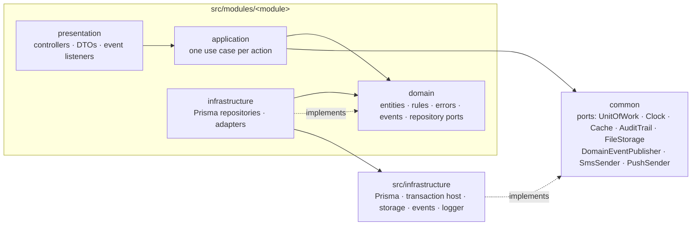
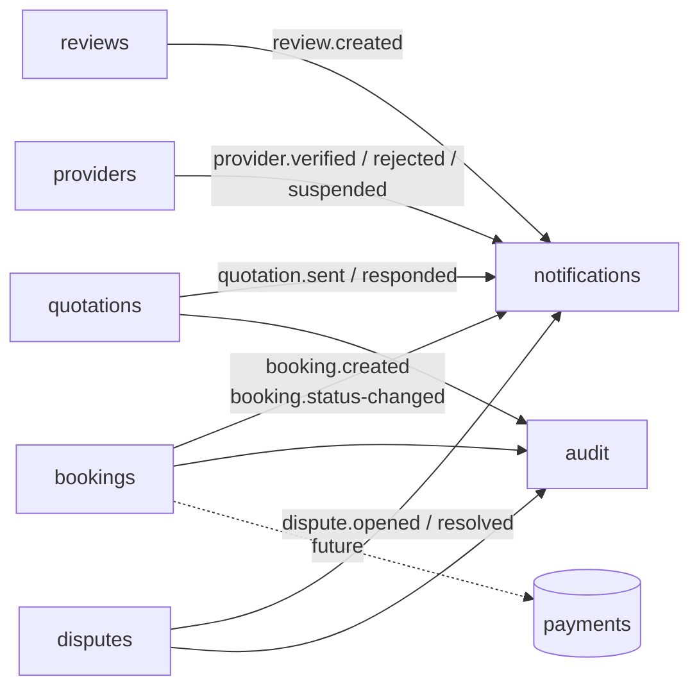

# SewaPro API

Backend for **SewaPro**, a local home-service marketplace for Nepal (Kathmandu first). Customers find and book verified providers (electricians, plumbers, carpenters, AC technicians, cleaners, mechanics); providers manage their offer, schedule and jobs; admins verify providers and run the platform.

NestJS 12 (ESM) · TypeScript 6 (strict) · PostgreSQL 18 + PostGIS + Prisma 7 · Vitest + Supertest · Bun (package manager) · Node 24 (runtime)

> **Status:** Steps 1–12 are complete, including nearby provider search with PostGIS (`GET /providers`, `GET /providers/:id`).

## Requirements

- Node.js **24** (`nvm use` reads `.nvmrc`)
- **Bun** 1.3+ (the only package manager; never npm, pnpm or yarn)
- PostgreSQL **18** with **PostGIS** and the `btree_gist` and `pg_trgm` contrib extensions: `brew install postgresql@18 postgis` (the Homebrew PostGIS bottle does not support PostgreSQL 16)
- No Docker is required for development.

## Setup

```bash
nvm use
bun install
cp .env.example .env      # set DATABASE_URL and the three secrets (openssl rand -base64 48)
createdb sewapro
createdb sewapro_test
bun run prisma:generate
bun run prisma:deploy     # apply migrations to the dev database
bun run db:seed           # admin + 6 categories / 27 services (+ 8 providers, 3 customers if SEED_SAMPLE_PASSWORD is set)
bun run start:dev
```

- API base: `http://localhost:3000/api/v1`
- Swagger UI: `http://localhost:3000/docs` · OpenAPI JSON: `/docs-json`
- Health: `GET /api/v1/health/live`, `GET /api/v1/health/ready`
- Local OTPs are printed in the log by the development SMS adapter (never in production).

## Scripts

| Script                                    | Purpose                                                       |
| ----------------------------------------- | ------------------------------------------------------------- |
| `bun run start:dev`                       | Run with watch mode                                           |
| `bun run build` / `bun run start:prod`    | Compile to `dist/` and run it                                 |
| `bun run verify`                          | Format check, lint, typecheck, cycle check, build, unit tests |
| `bun run test` / `bun run test:cov`       | Unit tests (coverage threshold 80%)                           |
| `bun run test:e2e`                        | E2E tests against `sewapro_test` (migrations applied first)   |
| `bun run lint` / `bun run lint:fix`       | ESLint (type-aware, layer-boundary rules)                     |
| `bun run format` / `bun run format:check` | Prettier                                                      |
| `bun run typecheck`                       | `tsc --noEmit`                                                |
| `bun run deps:cycles`                     | Fail on circular imports (madge)                              |
| `bun run prisma:generate`                 | Generate the Prisma client                                    |
| `bun run prisma:diff`                     | SQL diff from the dev DB to `schema.prisma` (new migration)   |
| `bun run prisma:deploy`                   | Apply migrations                                              |
| `bun run db:seed`                         | Idempotent seed                                               |

## Architecture

Modular monolith. Each module follows Clean Architecture; dependencies point inward only and ESLint enforces it (no NestJS or Prisma in `domain/`, no Prisma outside `infrastructure/`, no circular imports).



Modules communicate through exported repository ports and **domain events**, published after the transaction commits:



```
src/
├── main.ts · app.module.ts
├── bootstrap/        HTTP pipeline (helmet, CORS, prefix, versioning), Swagger
├── config/           Zod env schema + typed AppConfigService (fail fast)
├── common/           auth decorators, DomainError + codes, envelope, validation, pagination
│                     (offset + cursor), Nepal time, money, geo, upload policy, ports
├── infrastructure/   Prisma (+ transaction host), storage, events, audit writer, logger,
│                     messaging adapters, health, seed
└── modules/          bounded contexts (below)
```

## Modules

| Module          | Responsibility                                                                                                                                                                                           | Main routes                                                                                                        |
| --------------- | -------------------------------------------------------------------------------------------------------------------------------------------------------------------------------------------------------- | ------------------------------------------------------------------------------------------------------------------ |
| `auth`          | Registration; email + password and phone + OTP login; JWT access + rotating refresh tokens with reuse detection; global auth and role guards                                                             | `/auth/register`, `/auth/login`, `/auth/send-otp`, `/auth/verify-otp`, `/auth/refresh`, `/auth/logout`, `/auth/me` |
| `users`         | Own profile                                                                                                                                                                                              | `GET/PATCH /users/me`                                                                                              |
| `addresses`     | Customer addresses (max 10, one default)                                                                                                                                                                 | `/addresses` CRUD                                                                                                  |
| `catalog`       | Categories and services; cached public catalog; admin CRUD with soft delete or deactivation                                                                                                              | `GET /categories`, `GET /services`, `/admin/categories`, `/admin/services`                                         |
| `providers`     | Provider registration, profile, offerings and pricing, portfolio, private KYC documents, weekly availability, blocked dates, settings, dashboard, earnings; verification                                 | `POST /providers/register`, `/providers/me/*`, `/admin/providers/*`                                                |
| `bookings`      | Booking creation (availability, daily cap, service area, idempotency, no double booking), state machine, history, events, privacy                                                                        | `/bookings`, `/providers/me/bookings/*`                                                                            |
| `quotations`    | Provider quotations with server-computed totals, customer accept/decline, expiry job                                                                                                                     | `/providers/me/bookings/:id/quotations`, `/providers/me/quotations/:id/send`, `/bookings/:id/quotations/*`         |
| `reviews`       | One review per completed booking, transactional rating recompute, public listing, moderation                                                                                                             | `POST /bookings/:id/review`, `GET /providers/:id/reviews`, `/admin/reviews`                                        |
| `notifications` | Event-driven in-app notifications, push port, cursor pagination                                                                                                                                          | `/notifications`, `/notifications/unread-count`, `/notifications/:id/read`, `/notifications/read-all`              |
| `disputes`      | Raise on eligible bookings; admin review and resolution that sets the booking's final status                                                                                                             | `/disputes`, `/admin/disputes/*`                                                                                   |
| `audit`         | Audit rows from admin actions (in-transaction) and sensitive events (listeners); read-only API                                                                                                           | `GET /admin/audit-logs`                                                                                            |
| `admin`         | Dashboard, booking and growth reports (Nepal time), user suspension, booking monitoring                                                                                                                  | `/admin/dashboard`, `/admin/reports/*`, `/admin/users/*`, `/admin/bookings/*`                                      |
| `search`        | Public nearby search of verified, available providers (PostGIS `ST_DWithin`/`ST_Distance`, GiST index) with service, category, rating, price, experience, date and text filters; public provider profile | `GET /providers`, `GET /providers/:id`                                                                             |

## Conventions

- **Responses** `{ success: true, data, meta? }`; **errors** `{ success: false, error: { code, message, details?, requestId } }` with stable codes.
- **Use cases** throw `DomainError` subclasses only; one global filter maps `kind` → HTTP status.
- **Transactions:** `unitOfWork.run(() => …)`; repositories join it automatically. Events are published after commit.
- **Ownership:** use cases load resources scoped to the caller; another user's resource is 404 (no IDOR). Roles are enforced with `@Roles()`.
- **Pagination:** offset (`page`, `limit` ≤ 100) for lists; cursor for notifications. Lists without pagination are bounded by a business rule (≤ 10 addresses, ≤ 20 images, …).
- **Validation:** whitelist + forbid unknown properties (mass assignment), explicit transforms, Nepal phone normalisation to E.164.
- **Time:** instants are UTC `timestamptz`; schedules, blocked dates, reports and daily caps use Nepal time (UTC+05:45).
- **Money:** NPR with 2 decimals, `Decimal(12,2)` in the database, integer-paisa arithmetic in the domain.

Every decision and its reason is recorded in [`docs/DECISIONS.md`](docs/DECISIONS.md).

## Security

Argon2id passwords; HMAC-hashed OTPs with 5-minute expiry, 5 attempts and per-phone limits; hashed, rotating refresh tokens with family revocation; suspension effective within seconds; per-IP throttling with a stricter limit on credential routes; helmet; CORS allow-list; private KYC files behind expiring HMAC-signed URLs; uploads checked by magic bytes; secrets and signed-URL queries redacted from logs; audit log for admin and sensitive actions. The e2e suite includes an IDOR matrix over every `:id` route, mass-assignment probes and a rate-limit test.

## Testing

- `bun run test` — unit tests for every use case and domain rule (repositories mocked through their ports), including an exhaustive 256-case test of the booking state machine. Coverage of domain + application layers ≈ 97%.
- `bun run test:e2e` — the real `AppModule` against `sewapro_test`: every module's happy path, validation and 401/403/404/409 cases, database constraints (including concurrent double booking), the full marketplace journey, security checks, and an OpenAPI contract test that fails if any route lacks tags, summary, success or error responses.

## Adding a module

1. Create `src/modules/<name>/{domain,application,infrastructure,presentation}`.
2. **domain:** entities and pure rules, `DomainError` subclasses, events (`static NAME`), and repository ports as abstract classes. No NestJS, no Prisma.
3. **application:** one `@Injectable()` class per action with a single `execute()`. Depend on domain ports and `common/ports` only. Wrap multi-write work in `UnitOfWork.run`, publish events after it, and write `AuditTrail` entries for admin actions inside it.
4. **infrastructure:** Prisma repositories extending the ports, using `PrismaTransactionHost.client`; map rows to domain objects (never return Prisma models).
5. **presentation:** controllers that validate, call one use case and map to response DTOs; full Swagger decorators (`@ApiTags`, `@ApiAuth`, `@ApiOperation`, `@ApiEnvelopeResponse`/`@ApiPaginatedResponse`, `@ApiErrors`); `@Roles()` on everything not public.
6. Bind ports in `<name>.module.ts`, import it in `AppModule`, add a Swagger tag in `bootstrap/swagger.ts`.
7. Schema changes: edit `prisma/schema.prisma`, `bun run prisma:diff > prisma/migrations/<timestamp>_<name>/migration.sql`, review, `bun run prisma:deploy`.
8. Add unit tests for every use case and an e2e suite; `bun run verify` and `bun run test:e2e` must pass. Record decisions in `docs/DECISIONS.md`.

## Adding Payments later

Payments were deliberately left out (no tables, enums or endpoints). The extension points are ready:

1. Add a `payments` module with its own tables (e.g. `payments`, `payment_events`) and a `PaymentGateway` port in `common/ports` or the module's domain, with adapters for eSewa / Khalti in its infrastructure.
2. Subscribe to `booking.status-changed` (it carries `bookingId`, parties, `to` and `finalAmount`). On `COMPLETED`, create the charge or settlement; on `CANCELLED`, release any hold. `quotation.responded` provides the agreed estimate if deposits are wanted.
3. Commission and payouts belong in that module, keyed by `providerId`; `/providers/me/earnings-summary` can then read net amounts from it instead of `final_amount` totals.
4. If a payment must gate a transition (e.g. deposit before `ACCEPTED`), add a guard in the payments module's own use case and call `BookingTransitionService` from there. The state machine table stays the single source of transition rules.

No existing module needs to change except for wiring the new module into `AppModule`.

## Roadmap

1. ✅ Scaffold, config, Prisma, linting, Swagger, common layer
2. ✅ Schema, migrations, constraints, seed
3. ✅ Auth, Users, Addresses
4. ✅ Categories, Services, admin CRUD
5. ✅ Providers, documents, availability, admin verification
6. ✅ Search (PostGIS)
7. ✅ Bookings, state machine, history, events
8. ✅ Quotations
9. ✅ Reviews and rating recompute
10. ✅ Notifications, audit, disputes
11. ✅ Admin dashboard, reports, moderation
12. ✅ Hardening, full e2e, docs
